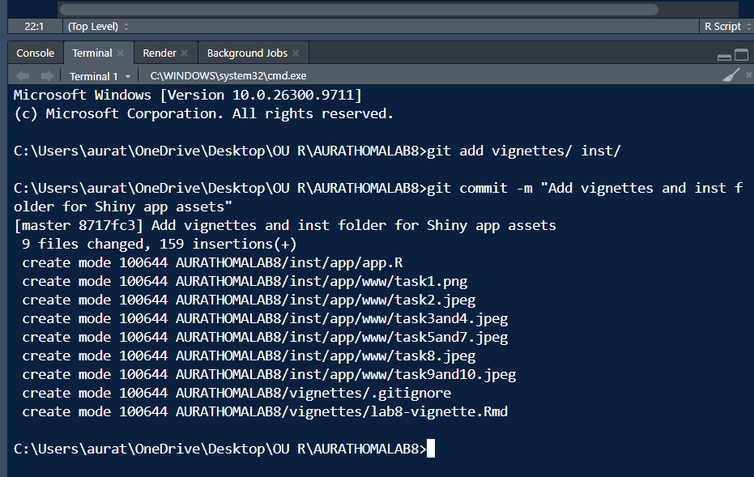

```{r setup, include = FALSE}
knitr::opts_chunk$set(
  collapse = TRUE,
  comment = "#>"
)
library(AURATHOMALAB8)
library(knitr)
```


```{r}
# call function
mysimA(iter = 1000)
```
```{r}
# call function 
mysimB(iter = 1000)
```
```{r}
# Generate the histogram and blue theoretical curve
histY(iter = 1000)
```

Commit




Check
── R CMD check results ─────────────────────────────────────────────────────────────── AURATHOMALAB8 0.1.0 ────
Duration: 18.1s
 checking installed package size ... NOTE
    installed size is 14.9Mb
    sub-directories of 1Mb or more:
      app  14.7Mb

0 errors ✔ | 0 warnings ✔ | 1 note ✖
